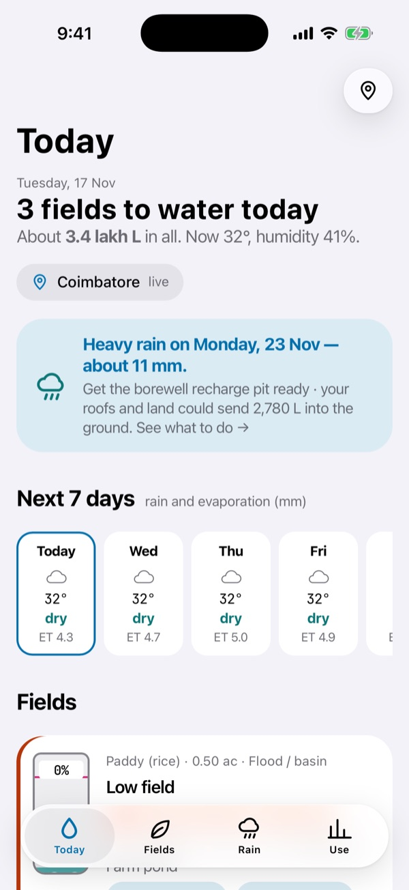
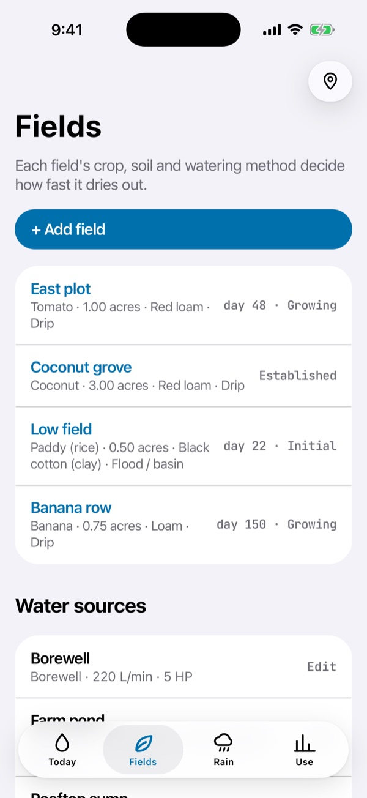
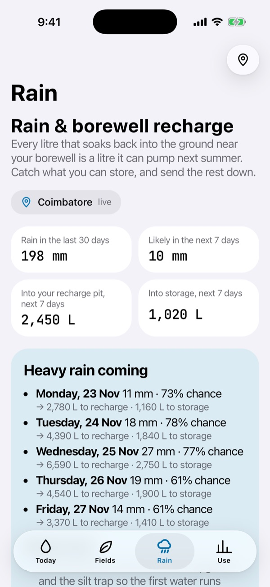
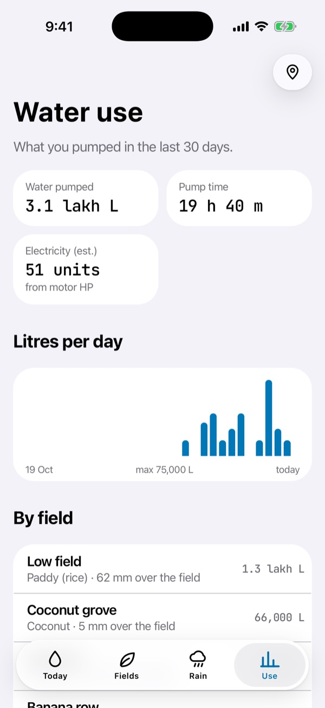

# Water Manager for iPhone

A native SwiftUI shell (WKWebView, iOS 17+) around the live web app at https://water-manager-beryl.vercel.app, generated from the
[Kolam iOS shell template](https://github.com/tgopinath/kolam-design-system/tree/main/ios/shell-template).
Inside this app the page switches to Apple's Human Interface Guidelines look (Kolam iOS kit: large titles,
Liquid Glass tab bar, back + centred title, sheets, haptics); in Safari or any other browser it keeps its Kolam look.
Web app source: https://github.com/tgopinath/water-manager

Location: "Use my location" is answered natively by CoreLocation (`GeoBridge` in AppWebView.swift), so there is one iOS permission prompt (NSLocationWhenInUseUsageDescription) and no second WebKit alert.

   

## Run it

```sh
xcodebuild -project WaterManager.xcodeproj -scheme WaterManager \
  -destination 'platform=iOS Simulator,name=iPhone 17 Pro' -derivedDataPath build CODE_SIGNING_ALLOWED=NO build
```

Then install `build/Build/Products/Debug-iphonesimulator/WaterManager.app` with `xcrun simctl install booted …`.
Debug builds accept `-KolamStartURL "<url>"` (open another route) and `-KolamJS "<line>"` (run one line of
JavaScript after the first load) on `simctl launch`, for screenshots.
Installing on other people's iPhones needs TestFlight or the App Store (Apple Developer Program).
